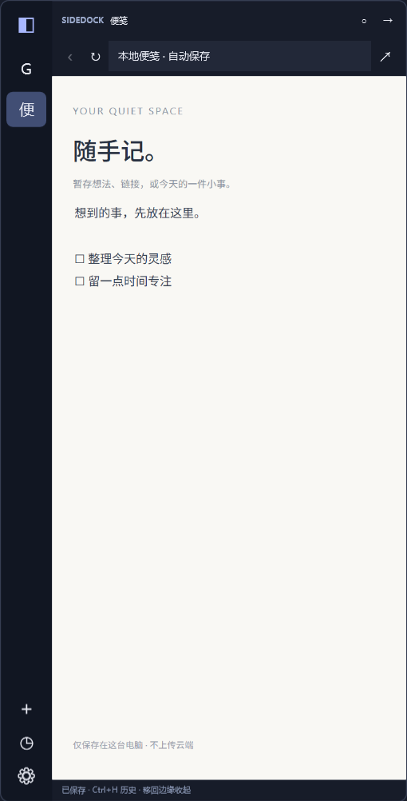

# SideDock

**Windows 上的侧边呼出浏览器：让常用网站留在屏幕边缘，需要时展开，用完后收起。**

[下载预发布版](https://github.com/czx-beauty/SideDock/releases/tag/v0.2.0) · [使用指南](docs/USAGE.zh-CN.md) · [构建](docs/BUILDING.md) · [隐私与数据](docs/PRIVACY.md) · [Apache-2.0](LICENSE)

## 开发缘起与正版支持

我喜欢 Slidepad 的侧边呼出体验，希望在 Windows 上获得类似的使用方式，因此借助 Codex 开发了 SideDock。它使用 WPF 与 Edge WebView2 独立实现，不是 Slidepad 的官方 Windows 版、源码移植版或授权产品，与 Slidepad 及其开发者无关联，未获其授权或背书。

**如果你使用 Mac，也喜欢这种工作方式，欢迎到 [Slidepad 官网](https://slidepad.app/) 了解并支持正版应用及原作者的持续维护。** 本项目不提供原版安装包、激活码或破解内容。

## 功能

- 左右热边缘呼出、自动收起、再次向屏幕外推鼠标收起，以及固定展开。
- 常用网站自动固定到侧栏，重复访问复用已有入口；切换保留网页实例。
- 普通链接在面板内打开，登录弹窗在面板内临时显示。
- Google 默认搜索，可在设置中填写其它搜索引擎网址或 `{query}` 模板。
- 全局快捷键、托盘、可配置的登录 Windows 后后台启动。
- 标签、最后 URL、浏览历史、网站本机存储及可恢复位置保存。
- 本地便笺、网站图标缓存。

## 下载与启动

当前版本 **0.2.0（预发布）**，面向 **Windows 10/11 x64**。

在 [Releases](https://github.com/czx-beauty/SideDock/releases) 下载安装版或便携版。安装后从开始菜单或桌面打开 SideDock；收起后可按 **Ctrl+Alt+Space**、触碰选定屏幕边缘，或点击托盘图标唤出。开机自启需要在设置中手动开启。

发行包包含 .NET 运行时；需要系统安装 [Microsoft Edge WebView2 Runtime](https://developer.microsoft.com/microsoft-edge/webview2/)。本版未做代码签名。升级前先从托盘退出旧版，保留个人数据再安装。

## 快捷键

| 操作 | 快捷键 |
|---|---|
| 全局展开 / 收起 | Ctrl+Alt+Space |
| 收起 | Esc |
| 地址栏 | Ctrl+L |
| 添加网站 | Ctrl+T |
| 刷新 | Ctrl+R |
| 历史记录 | Ctrl+H |

## 状态保留与限制

运行中切换会保留同一网页实例，因此输入和页面内容通常能继续使用。重启后恢复最后 URL、Cookie / 网站本机存储，并尽力恢复滚动及媒体位置；**不保证恢复网站未保存的草稿、临时回答或任意页面的完整内存状态**。

测试覆盖本地可控网页的路由、内嵌登录、会话恢复与安装卸载；没有代用户登录真实 DeepSeek、Google 或 YouTube，不能保证所有认证服务兼容。多屏、睡眠恢复和不同触控板仍需实际反馈。活动网页可能增加内存或继续播放视频。

未实现扩展、云同步、多账户隔离、MCP 或自动更新。[已知问题](docs/KNOWN_ISSUES.md)

## 数据、构建与参与

数据存放在 `%LOCALAPPDATA%\SideDock`，不读取主浏览器账号，卸载保留个人数据。网站自身仍会联网。[数据说明](docs/PRIVACY.md)

源码、依赖清单、测试、打包脚本均公开。[构建与自检](docs/BUILDING.md) · [参与贡献](CONTRIBUTING.md) · [安全问题](SECURITY.md)

欢迎提交 Issues，附版本、Windows 版本、缩放比例、屏幕数量和复现步骤。请勿上传 Cookie、浏览器数据或私人聊天。

## 许可与致谢

项目代码按 [Apache License 2.0](LICENSE) 提供；第三方组件保留各自许可，详见 [第三方声明](THIRD_PARTY_NOTICES.md)。该许可不授予 Slidepad、Microsoft 或其它第三方商标权。感谢 Slidepad 带来的产品灵感及 WPF、WebView2、.NET、NSIS 等工具。

This is an independent Windows side-panel browser, developed with assistance from Codex. It is not affiliated with or endorsed by Slidepad. Mac users are encouraged to support the original app at https://slidepad.app/.
